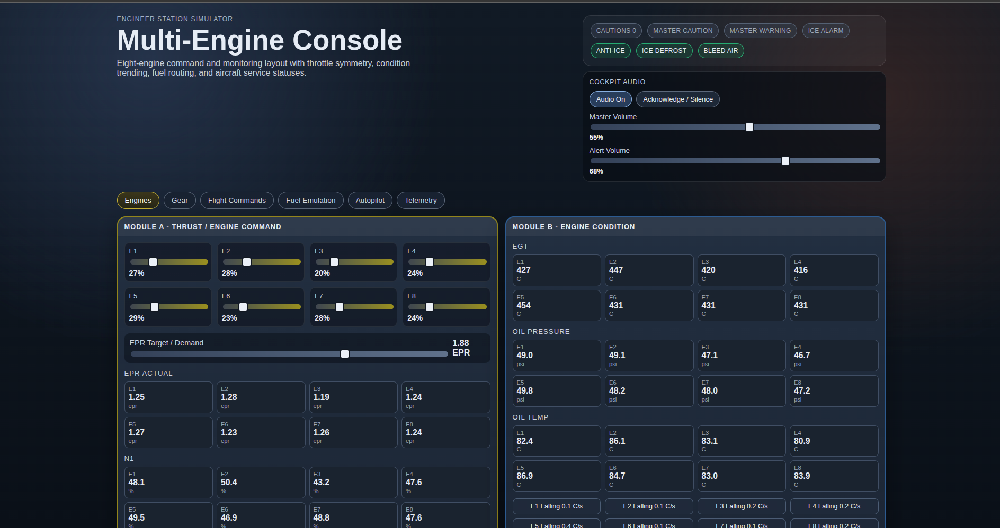
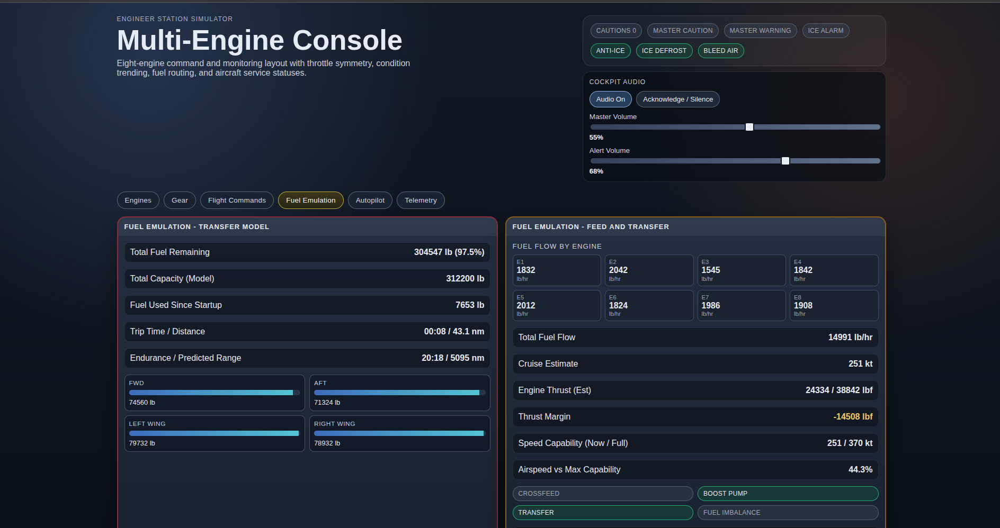
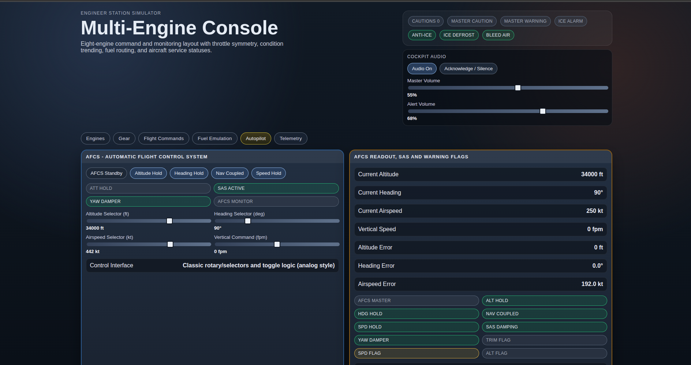
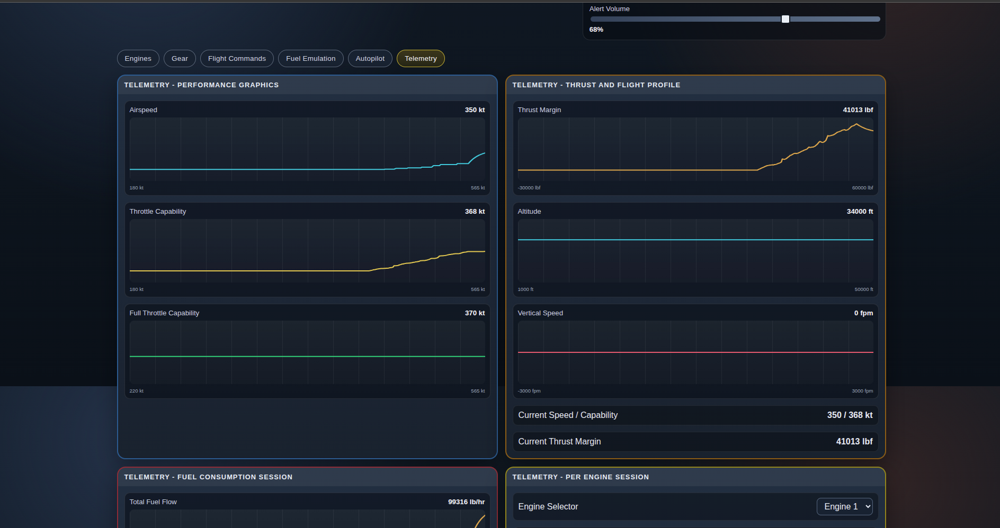
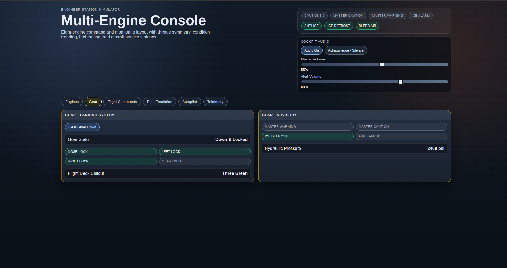
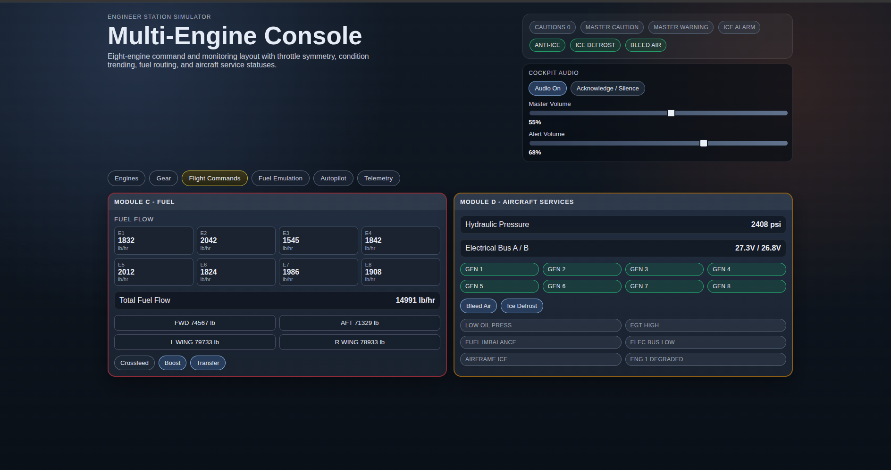
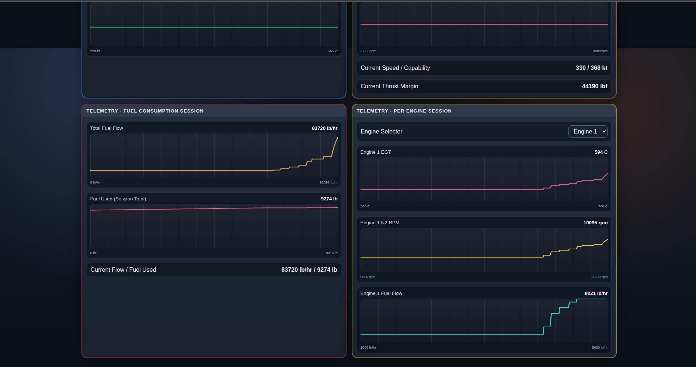
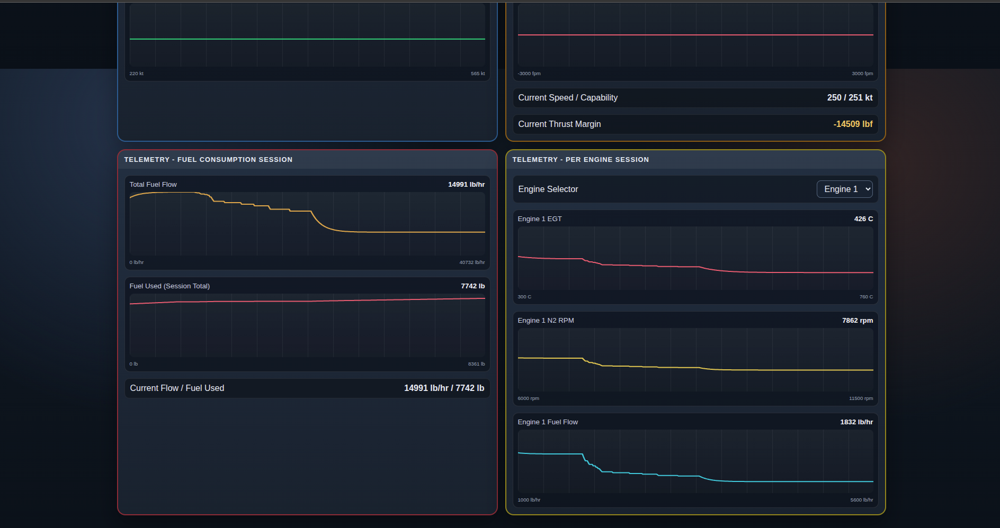
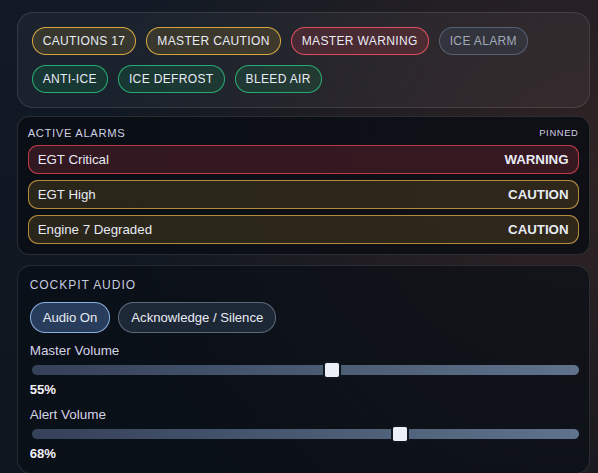
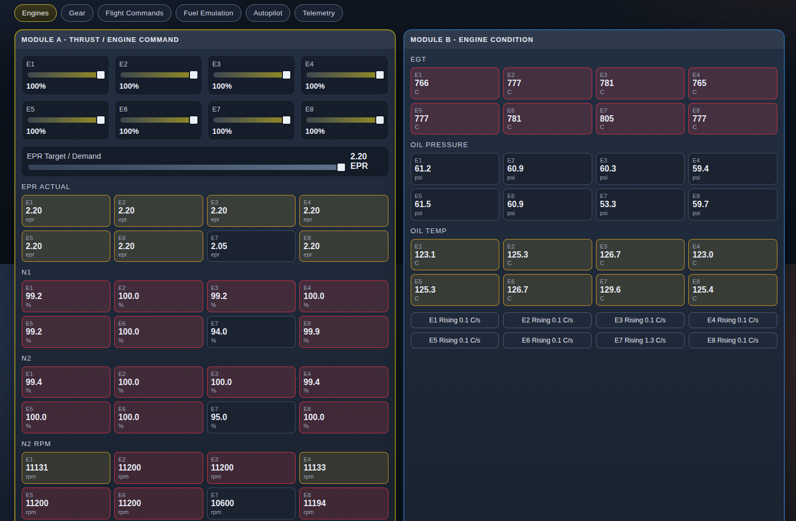

# EngineSyncConsole

A browser-based systems console that simulates a TF33-class eight-engine aircraft: spool dynamics, fuel routing, autoflight, alerts, and cockpit audio, driven by a deterministic, seedable simulation core.

Built with React 19 and Vite. The simulation core in `src/domain` is plain JavaScript with no React dependency, and the project is tested with Vitest.

> **Project history:** originally created in 2026, modernized in 2026.

> **Not for operational use.** This is an educational model for visualization and systems logic. It is not certified, not validated against flight data, and must not be used for training credit, flight planning, or engineering decisions.



## Why This Project Exists

Multi-engine systems are hard to reason about from static tables because the interesting behavior is coupled: a throttle change moves the spools, which moves thrust, fuel flow and temperature, which moves weight, speed and alert state. This project makes those couplings visible and interactive, and keeps the physics in a pure module so that the behavior can be tested, replayed, and studied without a browser.

## What It Does

| Area | Behavior |
| --- | --- |
| Engines | Eight independent throttles, N1/N2 first-order spool lag, EPR, RPM, EGT, oil pressure and temperature, EGT trend, single-engine fault injection |
| Fuel | Four tanks, two burn schedules, crossfeed equalization, boost and transfer controls, payload selection, endurance and range estimates |
| Autoflight | AFCS master, altitude hold, heading hold and nav coupled modes (both steer to the target heading), speed hold, autothrottle with a 5 second manual override |
| Alerts | Master warning and caution, per-engine annunciators, prioritized and acknowledgeable audio |
| Telemetry | Live trend charts over a rolling 360-sample window |
| Headless | A command-line scenario runner that emits reproducible JSON statistics |

## Architecture

The dependency rule points inward: the UI depends on the domain, and the domain depends on nothing.

```text
src/
  app/             Composition root, tab registry
  domain/          Pure, framework-free simulation core
    aircraft/      Airframe constants
    alerts/        Thresholds and alert rules
    atmosphere/    International Standard Atmosphere
    engine/        Spool dynamics and engine outputs
    flight/        Kinematics, heading control, autothrottle
    fuel/          Mass-conserving tank model
    math/          Seeded PRNG, numerics, statistics
    simulation/    State, step function, metrics, scenarios
    telemetry/     Performance estimates
  features/        One folder per console tab, plus simulation hooks
  infrastructure/  Audio engine and seed resolution
  ui/              Shared cockpit and layout components
  styles/          Global stylesheet
db/                Optional SQLite schema
scripts/           Headless simulator and test report writer
tests/             Unit, property-based, statistical, schema and UI tests
```

This is a client-only application with no server, so there is no frontend/backend split. See [docs/ARCHITECTURE.md](docs/ARCHITECTURE.md) for the model equations, complexity notes, and known limitations.

## Quick Start

Requires Node.js 24 (see `.nvmrc`).

```bash
npm ci --ignore-scripts
npm run dev
```

Open the URL Vite prints. Browsers block audio until the first interaction, so click any control to start the cockpit sound.

## Usage Guide

1. **Engines:** move the throttles and watch N1, N2, EGT and fuel flow lag behind the command. Enable a fault on one engine to see degraded output.
2. **Fuel Emulation:** set payload, toggle transfer and crossfeed, and watch tank levels, endurance and range respond.
3. **Autopilot:** engage AFCS, set targets, and enable Speed Hold. Moving a throttle by hand suspends the autothrottle for 5 seconds.
4. **Gear:** cycle the lever and observe transit and lock indications.
5. **Telemetry:** inspect speed, thrust margin, altitude, vertical speed and per-engine trends.
6. **Alerts:** use the header to acknowledge alerts and set the master and alert volumes.

### Reproducible Runs

Append a seed to fix the engine noise sequence in the browser:

```text
http://localhost:5173/?seed=42
```

Browser runs depend on timers and on when controls are moved, so exact replay is only guaranteed by the headless runner:

```bash
npm run simulate -- --seed 42 --duration 600
npm run simulate -- --seed 42 --duration 900 --autopilot --target-speed 420
```

The output is JSON containing the final state and summary statistics. The same seed and arguments produce the same output.

## Configuration

| Setting | Where | Values |
| --- | --- | --- |
| `seed` | URL query string | Integer from 0 to 4294967295. Invalid or missing values use a random seed |
| `--seed` | `npm run simulate` | Integer from 0 to 4294967295, default 42 |
| `--duration` | `npm run simulate` | 0.5 to 86400 seconds, rounded to the 0.5 second tick, default 600 |
| `--autopilot` | `npm run simulate` | Enables AFCS and speed hold |
| `--target-speed` | `npm run simulate` | 180 to 565 knots, default 442 |
| Aircraft model | `src/domain/aircraft/constants.js` | Engine count, tank capacity, limits, masses |
| Alert limits | `src/domain/alerts/thresholds.js` | Warning and caution thresholds |

The application uses no environment variables or secrets.

## Alert Logic

| Alert | Level | Condition |
| --- | --- | --- |
| EGT Critical | Warning | Any engine above 760 C |
| EGT High | Caution | Any engine above 700 C |
| Low Oil Pressure | Caution | Any engine below 35 psi |
| Oil Temp High | Caution | Any engine above 123 C |
| EGT Trend Abnormal | Caution | Absolute EGT rate above 7 C/s |
| Fuel Imbalance | Caution | Wing tank difference above 2.2% of total capacity |
| Throttle Asymmetry | Caution | Left and right bank average difference above 2.2% |
| Electrical Bus Low | Caution | Bus A or B below 25 V |
| Airframe Ice | Caution | Anti-ice is off |
| Engine Degraded | Caution | Fault injection is enabled |
| Gear Unsafe | Caution | Lever down, not locked, not in transit |
| Boost Pump Off, Fuel Transfer Off | Caution | The respective system is off |

Oil Temp High, EGT Trend Abnormal, Boost Pump Off and Fuel Transfer Off are visual only and play no audio. Electrical Bus Low cannot currently fire, because the modeled bus voltages never drop below 25.2 V. Gear Unsafe has no failure model. See the known limitations in [docs/ARCHITECTURE.md](docs/ARCHITECTURE.md).

## Database

The console does **not** use a database, and the schema is **optional**. [`db/schema.sql`](db/schema.sql) is a small SQLite schema for anyone who wants to store headless run results for analysis:

```bash
sqlite3 runs.db < db/schema.sql
```

## Testing

```bash
npm test             # Run the full suite
npm run test:report  # Run the suite and regenerate reports/tests/
npm run lint
npm run build
```

The suite covers property-based invariants (fuel mass conservation, envelope bounds, heading convergence), statistical checks of the PRNG (chi-square uniformity, moments, serial correlation), International Standard Atmosphere reference values, seeded reproducibility, schema constraints, command-line validation, test report integrity, and UI behavior.

The latest committed run is in [reports/tests/SUMMARY.md](reports/tests/SUMMARY.md).

## Security Notes

The application has no accounts, forms, network API, persistence, or secrets. Production builds ship a restrictive Content Security Policy, the only external input (`seed`) is strictly validated, and CI uses read-only permissions with actions pinned to commit hashes. See [SECURITY.md](SECURITY.md) and [docs/SECURITY_AUDIT.md](docs/SECURITY_AUDIT.md).

## Screenshots

These screenshots were captured before the 2026 modernization and have not been recaptured.

| Engines | Fuel Emulation |
| --- | --- |
|  |  |

| Autopilot | Telemetry |
| --- | --- |
|  |  |

| Gear | Flight Commands |
| --- | --- |
|  |  |

| Fuel Session | Low-Burn Session |
| --- | --- |
|  |  |

| Alert Panel | High-Power Alert |
| --- | --- |
|  |  |

## License and Attribution

Source code is released under the [MIT License](LICENSE). The engine model is loosely based on publicly known characteristics of the Pratt & Whitney TF33 / JT3D family and is not affiliated with or endorsed by any manufacturer.

The origin and license of the audio files in `public/sounds/` are not documented in this repository, so the MIT grant should not be assumed to cover them.
