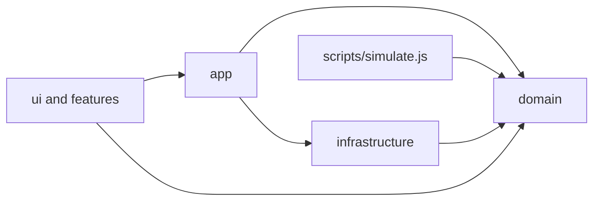
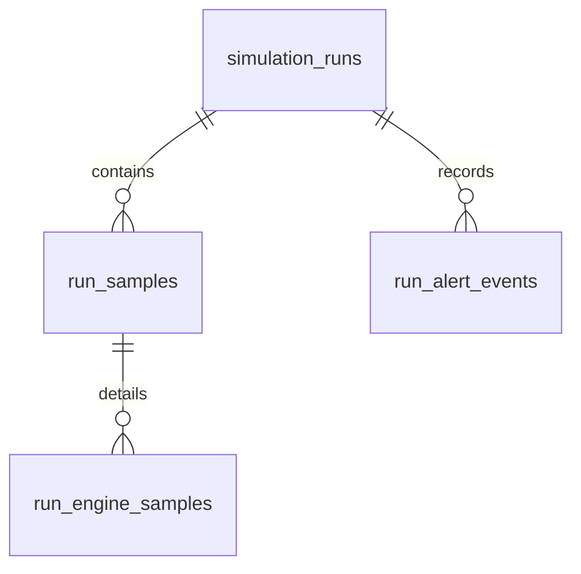

# Architecture

## Goals

1. Keep all simulation behavior in pure functions that run without a browser.
2. Make every run reproducible from a seed and a control sequence.
3. Keep React responsible only for state wiring and rendering.

## Layers



| Layer | Responsibility | May depend on |
| --- | --- | --- |
| `src/domain` | Physics, alert rules, statistics, scenarios | Nothing outside itself |
| `src/infrastructure` | Howler audio, seed resolution | `domain`, browser APIs |
| `src/features` | One folder per tab, React simulation hooks | `domain`, `ui` |
| `src/ui` | Reusable presentational components | React |
| `src/app` | Composition root and top-level state | All of the above |

Domain modules use explicit `.js` import extensions so that Node.js can run them directly, without a bundler.

## Simulation Pipeline

`stepSimulation(previous, throttles, controls, dt)` is a pure function. The PRNG state is part of the simulation state, so calling it twice with the same input returns the same output, which also makes it safe under React StrictMode double invocation.

```text
throttles + controls
  -> engine update (spool lag, noise, outputs)
  -> fuel draw (schedule, rerouting, shortfall)
  -> delivered-fuel scaling of thrust and flow
  -> crossfeed equalization
  -> performance estimate
  -> kinematics (speed, vertical speed, altitude)
  -> heading control
  -> next state
```

The fixed tick is 0.5 s. The autothrottle runs at 10 Hz and slews throttle commands, so it only influences the aircraft through the engine model.

## Models

### Spool Dynamics

Spools are first-order lags, integrated with the exact discretization:

$$x_{k+1} = x_k + (x^* - x_k)\left(1 - e^{-\Delta t / \tau}\right)$$

This is unconditionally stable, never overshoots, and gives the same result whether a step is taken whole or subdivided. Time constants are asymmetric, in seconds: N2 is 4.6 up and 7.4 down, N1 is 5.4 up and 8.2 down.

### Engine Outputs

With $f = \mathrm{clamp}((N_1 - 30) / 70, 0, 1)$ and health $h$:

$$T = 17000 \, f^{2.25} \, h \quad \text{lbf}$$

$$\dot m_f = (\dot m_{idle} + T \cdot TSFC) \cdot k_{boost}$$

TSFC starts from 0.76 lb/(lbf h) and rises at high throttle and with degraded health. These are empirical curves chosen to resemble the TF33 class, and are not fitted to engine data.

### Sensor Noise

N1 and EGT noise are low-pass filtered uniform processes, bounded to +/-0.5% and +/-5 C. Noise is applied to the output only: the underlying N1 state (`n1Core`) does not integrate it, so noise cannot accumulate as a random walk.

### Random Numbers

The PRNG is Mulberry32: 32 bits of state with a period of 2^32. It is fast, compact, and suited to simulation noise. It is **not** cryptographically secure and is never used for security decisions.

### Fuel

`drawFuel` splits demand across tanks using the active schedule. When a tank empties, its share is rerouted to the remaining tanks in proportion to their weights. Each pass either satisfies the demand or empties at least one tank, so at most five passes are needed. The invariant, covered by property tests, is:

$$\sum m_{tank}^{before} - \sum m_{tank}^{after} = m_{delivered}$$

If demand exceeds the remaining fuel, thrust and fuel flow scale by the delivered fraction and reach zero when the tanks are empty.

### Atmosphere

`isaRatios` implements the International Standard Atmosphere for the troposphere (lapse rate 6.5 K/km) and the isothermal layer up to 20 km, treating altitude as geopotential:

$$\delta = \theta^{\,g / (L R)}, \qquad \sigma = \delta / \theta$$

Above 11 km, $\delta = \delta_{11} \, e^{-g (h - h_{11}) / (R T_{11})}$.

### Kinematics

Speed and altitude use explicit Euler integration, with acceleration limited to +/-4 kt/s. Vertical speed follows its command through a first-order lag. In altitude-managed modes the command is proportional to altitude error: the gain is 0.12 fpm/ft outside the 350 ft capture band and 0.08 fpm/ft inside it, which gives a capture time constant of 12.5 minutes. Climb commands are bounded by excess specific power:

$$\dot h_{max} \propto \frac{(T - D)\,V}{W}$$

### Autothrottle

A proportional-integral controller with feed-forward from the target speed, climb compensation, a clamped integrator for anti-windup, and a slew limit of 1.6% per update.

## Complexity

With $E = 8$ engines, $K = 4$ tanks, and $H = 360$ telemetry samples:

| Operation | Time | Space |
| --- | --- | --- |
| `stepSimulation` | $O(E + K^2)$ | $O(E + K)$ |
| `drawFuel` | $O(K^2)$ worst case | $O(K)$ |
| `computeMetrics` | $O(E + K)$ | $O(E)$ |
| Telemetry history append | $O(H)$ | $O(H \cdot E)$ |
| `runScenario` for $n$ ticks | $O(n (E + K^2))$ | $O(n)$ |
| `summarize` (Welford) | $O(n)$ | $O(1)$ |

## Persistence

The console holds all state in memory. `db/schema.sql` is an optional SQLite schema for storing headless results:



## Known Limitations

- Kinematics and telemetry use **two different drag models**, so the displayed thrust margin is not the force that accelerates the aircraft.
- Engine thrust does not lapse with altitude in the simulation loop. Thrust lapse only appears in the telemetry estimate when no measured thrust is supplied.
- With empty tanks thrust drops to zero, but spool speeds and temperatures do not model a flameout.
- The `Gear Unsafe` condition has no failure model. It can only appear for a single render when the lever moves down, before the transit state is set.
- Ferry and combat range projections are heuristic multipliers.
- The speed and altitude integrators are first order.
- `AIRCRAFT_MASS.maxFuelLb` (312,197 lb) differs slightly from the sum of the tank capacities (312,200 lb). The simulation uses the tank sum.

## Recommended Evolution

1. Unify drag into one lift and drag polar shared by kinematics and telemetry.
2. Add Mach-dependent thrust lapse using the existing atmosphere module.
3. Move the simulation into a Web Worker to isolate it from render timing.
4. Replace the Euler integrators with RK4, using the property tests as a safety net.
